# jeryd (@UberMetroid)

**Systems Programmer & Open Source Architect**

Building capability-secure runtimes, verifiable supply-chain tooling, and native Linux & Wayland desktop primitives.

[Website](https://ubermetroid.github.io) • [Kelp](https://ubermetroid.github.io/kelp/) • [studio2201](https://studio2201.com) • [openOODA](https://openooda.org) • [IdleScreen](https://idlescreen.github.io) • [Necrometer](https://necrometer.dev) • [🎓 Tuition, Not Coffee](https://ubermetroid.github.io/tuition-not-coffee/)

 

---

## Organizations & Ecosystems

### [openOODA](https://github.com/openOODA) · [openooda.org](https://openooda.org)
> **Capability-secure systems programming language for the AI era.**
- Every external effect requires an explicit, unforgeable capability token — fail-closed by design.
- Self-hosted Merkle-AST compiler (`oodac`), Landlock/PQC host substrate (`oodar`), 8-domain standard library (`std`), package manager (`opm`), LSP/MCP servers (`lsp`, `mcp`), and TUI harness (`tui`).
- **258+** capability-bounded POSIX and system replacements in [openOODA-tools](https://github.com/openOODA-tools) (`oosh`, `oogrep`, `oojq`, `oofind`, `oodiff`, `ootail`, `oolandlock`, `oomcprun`, and more).

### [studio2201](https://github.com/studio2201) · [studio2201.com](https://studio2201.com)
> **Post-2030 software supply chain governance and attestation.**
- Five Apache-2.0 auditing tools built with **pure `std::` Rust** (0 crates from crates.io) and strictly **&le; 256 LOC per file**:
  - [**Snip**](https://github.com/studio2201/snip): Vibe-code, secrets, and PII static analyzer for LLM-generated diffs.
  - [**Vigil**](https://github.com/studio2201/vigil): Dependency dormancy and unmaintained library scanner across npm, cargo, and pip.
  - [**Aegis**](https://github.com/studio2201/aegis): NIST Post-Quantum Cryptography (PQC) migration scanner flagging deprecated RSA call sites.
  - [**Proven**](https://github.com/studio2201/proven): SLSA L3+ attestation engine signed with pure std ML-DSA-65.
  - [**Boneyard**](https://github.com/studio2201/boneyard): Repository health scoring and dormant public asset radar.

### [IdleScreen](https://github.com/idlescreen) · [idlescreen.github.io](https://idlescreen.github.io)
> **Wayland-native ambient display and 16-bit arcade screensaver suite (`v4.6.3`).**
- Unified single-binary architecture with an event-driven daemon at 0.00% CPU at idle (~2–3 MB resident), 10-bit HDR deep color, 4K 2x GPU scaling via `wp_viewporter`, dynamic 60–144 Hz refresh matching, and hardware DPMS monitor power-off.
- **52 built-in 16-bit arcade, demoscene, and mathematical scenes**, interactive TUI director with live mini-preview, headless AV1/H.264 video engine ([`studio`](https://github.com/idlescreen/studio)), and signed APT/RPM/Arch [`packages`](https://github.com/idlescreen/packages) channel.

---

## Notable Projects & Tools

| Project | Description | Tech Stack |
| :--- | :--- | :--- |
| [**kelp**](https://github.com/UberMetroid/kelp) · [site](https://ubermetroid.github.io/kelp/) | Hyprland-style automatic window tiling (**Octopus** 2D grid, **Seahorse** scrolling strip, **Otter** floating), tabbed stacking, and active focus borders for GNOME 45–51 on Wayland. | GJS, Libadwaita, Wayland |
| [**glances-rs**](https://github.com/UberMetroid/glances-rs) · [site](https://ubermetroid.github.io/glances-rs/) | Zero-dependency Linux system monitor in one static binary. 24 plugins, 18 exporters, and full REST, SSE, XML-RPC, MCP, CSV, and JSON surfaces. | Pure Rust `std::` |
| [**necrometer**](https://github.com/necrometer-dev/necrometer) · [necrometer.dev](https://necrometer.dev) | Measures how dead your GitHub repositories are. Zero-server Seance engine compiling to native CLI, WebAssembly, and daily [`necrometer-action`](https://github.com/necrometer-dev/necrometer-action) SVG cards. | Rust, WebAssembly, SMIL SVG |
| [**ahamkara**](https://github.com/UberMetroid/ahamkara) · [site](https://ubermetroid.github.io/ahamkara/) | Canonical archive and Rust query engine for the Ahamkara wish-dragons of Destiny — living interactive concordance included. | Rust, TypeScript, Pages |
| [**beatniks-bumtrips-bullshit**](https://github.com/bumtrips/beatniks-bumtrips-bullshit) | Audio archive and field recordings exploring literature, consciousness, and counterculture. | Static Web, Audio |

---

## Engineering Constitution

1. **Pure Standard Library**: Favor zero-dependency architectures (`std::` only) where attack surfaces and supply-chain hygiene matter.
2. **Explicit Capabilities**: Zero ambient authority; all side-effects must carry verifiable capability tokens.
3. **Strict Bounds & Locality**: Maintain disciplined line-of-code budgets (&le; 256 LOC per file) to prevent architectural rot and keep code human- and agent-comprehensible.
4. **Deterministic & Verifiable**: Bit-for-bit reproducible builds, cryptographic provenance attestations, and formal verification gates.

---

🎓 **[Tuition, Not Coffee](https://ubermetroid.github.io/tuition-not-coffee/)** — *I already have plenty of coffee. 100% of sponsorships for my open-source projects go directly toward my daughter's college & future fund.*

