# jeryd (@UberMetroid)

**Systems Programmer & Open Source Architect**

Building capability-secure computing stacks, zero-dependency systems & agent
tooling, post-quantum supply-chain gates, and Wayland-native desktop software.

[Website][site] • [openOODA][openooda-site] • [studio2201][studio-site] •
[agent-ooda][agent-ooda-site] • [Necrometer][necrometer-site] •
[🎓 Tuition, Not Coffee][tuition]

 

---

## Organizations & Ecosystems

### [openOODA][openooda-gh] · [openooda.org][openooda-site]
> **Capability-secured `L0`–`L7` computing stack built in native `.oo`.**
- Zero ambient authority: every external effect requires an explicit,
  single-cycle 64-bit hardware/software capability token (`CapReg64`).
- **L0 Toolchain ([`@openOODA-core`][oo-core])**: master CLI (`ooda`), native
  compiler (`oodac`), runtime (`oodar`), scientific & PQC standard library
  (`oostd`), package manager (`oopm`), `oolsp`, `oomcp`, and 8-hat formal
  verifier (`oohat`).
- **Full Stack (`105` product binaries across `L0`–`L7`)**: microkernel & UEFI
  bootloader ([`@openOODA-kernel`][oo-kernel]), zero-root daemons
  ([`@openOODA-OS`][oo-os]), `39` sandboxed utilities
  ([`@openOODA-tools`][oo-tools]), Wayland compositor & desktop
  ([`@openOODA-DE`][oo-de]), `16` native apps ([`@openOODA-apps`][oo-apps]),
  mesh cloud ([`@openOODA-cloud`][oo-cloud]), and autonomous OODA loops
  ([`@openOODA-agents`][oo-agents]) — shipped via
  [`openOODA/install@hub`][oo-hub] and signed [`openOODA/catalog`][oo-catalog].

### [studio2201][studio-gh] · [studio2201.com][studio-site]
> **Wayland-native GNOME suite & zero-dependency CI/CD supply-chain lab.**
- **CI/CD Supply-Chain & Post-Quantum Gates**: five Apache-2.0 tools in pure
  `std::` Rust (`0` `crates.io` crates, ≤ `256` LOC/file) orchestrated via
  [`studio2201/cli`][st-cli] and [`studio2201/studio2201`][st-action]:
  - [**Snip**][st-snip]: vibe-code, secrets, PII, and broken-auth diff scanner.
  - [**Vigil**][st-vigil]: dormant and unmaintained dependency scanner.
  - [**Aegis**][st-aegis]: NIST Post-Quantum Cryptography readiness auditor.
  - [**Proven**][st-proven]: reproducible builds and pure-std ML-DSA-65 proof.
  - [**Boneyard**][st-boneyard]: org-wide repository health and debt scorer.
- **Ocean Desktop Suite (GNOME Shell 45–50 on Wayland)**: `100%` in-process
  extensions (`0` `shexli` errors/warnings) with one-click suite color sync:
  [**Kelp**][st-kelp] (Octopus 2D grid / Seahorse scroller / Otter floating
  tiler), [**Reef**][st-reef] (window-dodge dock & panel), [**Tide**][st-tide]
  (`Super` app & window launcher), [**Coral**][st-coral] (app grid &
  auto-folders), [**Seabed**][st-seabed] (desktop icons), [**Shoal**][st-shoal]
  (Wayland `SNI`/AppIndicator tray), and [**Sonar**][st-sonar] (8-bit stereo
  spectrum corners).

---

## Projects & Tools

<table>
  <thead>
    <tr>
      <th align="left">Project</th>
      <th align="left">Description</th>
      <th align="left">Stack</th>
    </tr>
  </thead>
  <tbody>
    <tr>
      <td>
        <a href="https://github.com/UberMetroid/agent-ooda"><strong>agent-ooda</strong></a>
        · <a href="https://ubermetroid.github.io/agent-ooda/">site</a>
      </td>
      <td>
        Zero-dependency static Go (<code>CGO_ENABLED=0</code>) OODA multi-agent router,
        cross-model diff verifier, isolated worktree fan-out, and live NDJSON
        <code>tok/s</code> HUD (<code>agy</code> plugin today; <code>mcode</code> next).
      </td>
      <td>Go stdlib</td>
    </tr>
    <tr>
      <td>
        <a href="https://github.com/necrometer-dev/necrometer"><strong>necrometer</strong></a>
        · <a href="https://necrometer.dev">site</a>
      </td>
      <td>
        Measures how dead your GitHub repos are — zero-server Seance engine compiling to
        native CLI, WASM, and daily
        <a href="https://github.com/necrometer-dev/necrometer-action"><code>necrometer-action</code></a>
        SMIL SVG gauges.
      </td>
      <td>Rust, WASM, SMIL SVG</td>
    </tr>
    <tr>
      <td>
        <a href="https://github.com/UberMetroid/ahamkara"><strong>ahamkara</strong></a>
        · <a href="https://ubermetroid.github.io/ahamkara/">site</a>
      </td>
      <td>
        Canonical archive and Rust query engine for the Ahamkara wish-dragons of Destiny —
        living interactive concordance included.
      </td>
      <td>Rust, TypeScript</td>
    </tr>
    <tr>
      <td>
        <a href="https://github.com/bumtrips/beatniks-bumtrips-bullshit"><strong>beatniks-bumtrips-bullshit</strong></a>
        · <a href="https://bumtrips.com">site</a>
      </td>
      <td>
        Field-recorded podcast and audio archive exploring literature, consciousness, and
        counterculture.
      </td>
      <td>Static Web, Audio</td>
    </tr>
  </tbody>
</table>

---

## Engineering Constitution

1. **Zero-Dependency Standard Library**: Favor pure `stdlib` builds (native
   `.oo`, `std::` Rust, `CGO_ENABLED=0` Go) to eliminate supply-chain bloat.
2. **Explicit Capabilities**: Zero ambient authority; every external effect
   requires an unforgeable capability token and fails closed.
3. **Power-of-2 Code Shape**: Enforce strict structural bounds (`1` role per
   module, `2` test axes, ≤ `4` nesting levels, ≤ `64` LOC/fn,
   ≤ `128` cols, ≤ `256` LOC/file) for human and agent legibility.
4. **Deterministic & Verifiable**: Reproducible single static binaries,
   post-quantum ML-DSA-65 provenance, and independent cross-model / 8-hat
   verification gates.

---

🎓 **[Tuition, Not Coffee][tuition]** — *I already have plenty of coffee. 100%
of sponsorships for my open-source projects go directly toward my daughter's
college & future fund.*

[site]: https://ubermetroid.github.io
[openooda-site]: https://openooda.org
[openooda-gh]: https://github.com/openOODA
[studio-site]: https://studio2201.com
[studio-gh]: https://github.com/studio2201
[agent-ooda-site]: https://ubermetroid.github.io/agent-ooda/
[necrometer-site]: https://necrometer.dev
[tuition]: https://ubermetroid.github.io/tuition-not-coffee/

[oo-core]: https://github.com/openOODA-core
[oo-kernel]: https://github.com/openOODA-kernel
[oo-os]: https://github.com/openOODA-OS
[oo-tools]: https://github.com/openOODA-tools
[oo-de]: https://github.com/openOODA-DE
[oo-apps]: https://github.com/openOODA-apps
[oo-cloud]: https://github.com/openOODA-cloud
[oo-agents]: https://github.com/openOODA-agents
[oo-hub]: https://github.com/openOODA/install/releases/tag/hub
[oo-catalog]: https://github.com/openOODA/catalog

[st-cli]: https://github.com/studio2201/cli
[st-action]: https://github.com/studio2201/studio2201
[st-snip]: https://github.com/studio2201/snip
[st-vigil]: https://github.com/studio2201/vigil
[st-aegis]: https://github.com/studio2201/aegis
[st-proven]: https://github.com/studio2201/proven
[st-boneyard]: https://github.com/studio2201/boneyard

[st-kelp]: https://studio2201.github.io/kelp/
[st-reef]: https://studio2201.github.io/reef/
[st-tide]: https://studio2201.github.io/tide/
[st-coral]: https://studio2201.github.io/coral/
[st-seabed]: https://studio2201.github.io/seabed/
[st-shoal]: https://studio2201.github.io/shoal/
[st-sonar]: https://studio2201.github.io/sonar/
